<div align="center">
  

  <h1>GPT-SoVITS-Studio</h1>

  <p><strong>把 GPT-SoVITS v5turbo 语音合成和 SenseVoice 语音识别，收进一个干净、本地优先的 Windows 桌面工作台。</strong></p>
  <p><em>A local-first Windows desktop studio for GPT-SoVITS v5turbo TTS and SenseVoice ASR.</em></p>

  <p>
    
    
    
    
    
  </p>

  <p>不打开浏览器 · 不启动本地端口 · 不上传音频和文本</p>
</div>

<p align="center">
  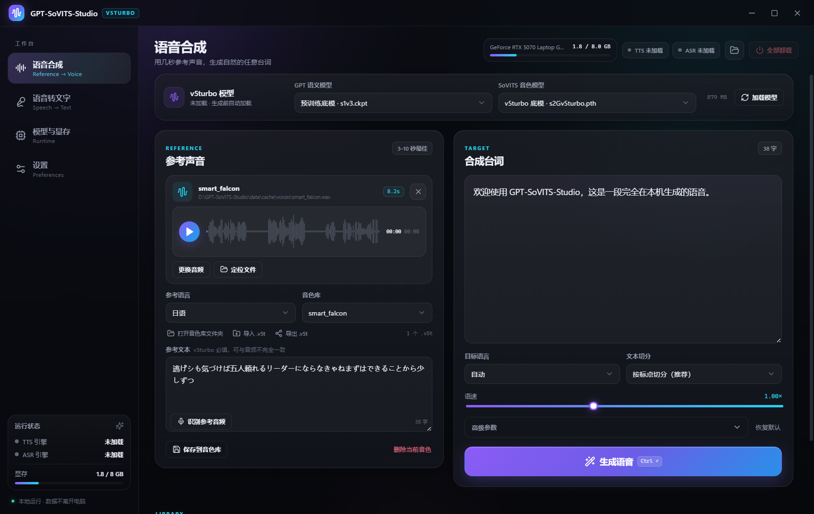
  <br />
  <sub>彩色深色主题 · 参考声音 / 合成台词 / 模型状态 / 音色库</sub>
  <br />
  <sub>截图中的路径、音色和文本仅用于演示。</sub>
</p>

---

## 这是什么？

**GPT-SoVITS-Studio** 是一个面向 Windows 的桌面工作台，把两件事放进同一个应用：

- **语音合成**：用 3–10 秒参考声音 + 参考文本，生成任意台词的 v5turbo 语音。
- **语音转文字**：用 SenseVoice 做本地中 / 英 / 日 / 韩 / 粤识别。

它不是 Gradio WebUI 的简单套壳。Electron 主进程直接管理两个独立的 Python worker，模型加载、分段进度、显存占用和释放都由桌面端接管；UI 通过 IPC 与主进程通信，不开放本地 HTTP 端口。

> 所有模型推理都在本机完成。音频、文本、历史记录和音色库都保存在应用目录内，不经过任何云端服务。

> **快速开始**：在 Releases 下载 `GPT-SoVITS-Studio-Setup.exe` 和 `GPT-SoVITS-Studio-Portable.7z` → 放在同一文件夹 → 双击 Setup.exe → 选择路径安装。

---

## 功能一览

| 能力 | 说明 |
| --- | --- |
| **v5turbo 语音合成** | 直接调用 `GPT_SoVITS.TTS_infer_pack.TTS`，支持零样本音色克隆 |
| **参考声音** | 拖入 3–10 秒音频，自动标准化为 48kHz 单声道 WAV，可一键识别参考文本 |
| **SenseVoice 识别** | 中 / 英 / 日 / 韩 / 粤，本地推理；结果可编辑、批量导出 `.list` / `.txt` |
| **发送到生成参考** | ASR 结果一键带回语音合成页，音频、文本和语言同时填入 |
| **`.v5t` 音色库** | 每个音色一个文件，包含参考音频、文本和语言；可分享、导入、导出 |
| **高级参数** | top_k / top_p / temperature / 重复惩罚 / 并行段数 / 采样步数 4·8·16·32 |
| **随机种子** | 种子为 `-1` 时自动记录实际值；结果卡和历史记录都支持一键复用 |
| **同步字幕** | 逐句生成并按真实音频算出时间轴，一键导出 SRT / ASS / LRC，可直接进剪辑软件 |
| **显存管理** | 展示每个引擎的显存占用；切换自动卸载、空闲自动释放；托盘右键可一键卸载 |
| **托盘与关闭** | 点 × 可选「最小化到托盘」或「直接退出」，记住选择；托盘常驻并提供卸载 / MCP 开关 |
| **两套主题风格** | 彩色 / 黑白，每套支持深色 / 浅色 / 跟随系统；默认黑白 + 跟随系统 |
| **AI / MCP** | 内置 MCP 服务，Claude Code、Codex、Cursor、opencode 等可一键接入或让 agent 自己装 |
| **分段重生** | 长文本只重做其中一句或几句：改种子 / 参数 / 文本，先试听再替换，可撤销 |
| **说话人分离** | CAM++ 区分说话人，逐句带时间与文本；按说话人建音色、做译制配音 |
| **两种分发** | 绿色便携目录，或黑白浅色安装器（选择路径 + 桌面快捷方式） |

---

## 界面

### 语音合成

参考声音、音色库、参考文本、目标台词、语速和切分方式都在同一屏。第一次生成会自动加载模型，后续生成通常只需几秒。

<p align="center">
  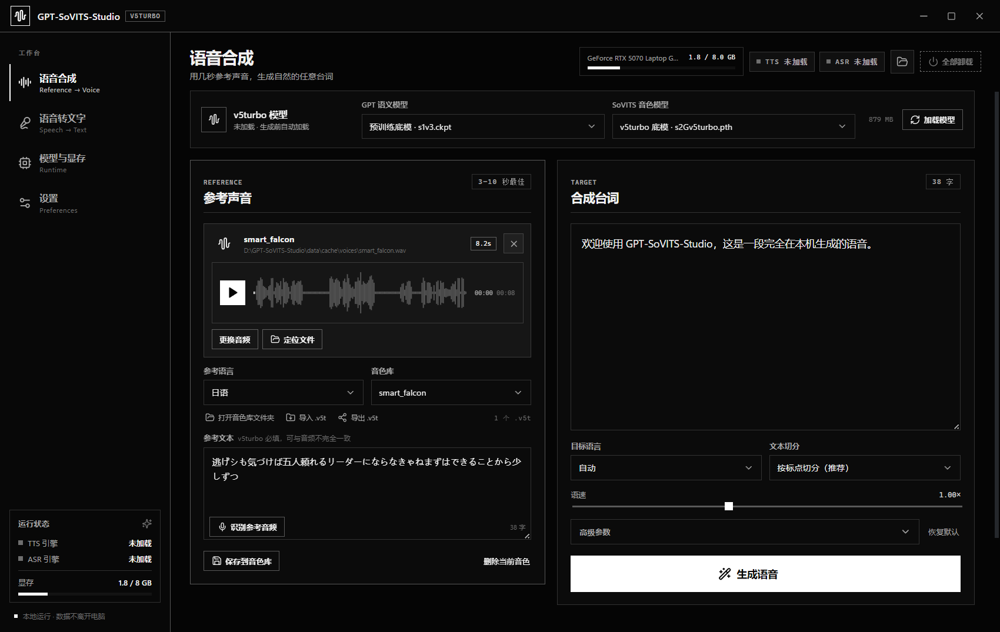
  <br />
  <sub>黑白深色主题 · 已选择示例音色 smart_falcon</sub>
</p>

| 生成结果 | 高级参数 |
| :---: | :---: |
| 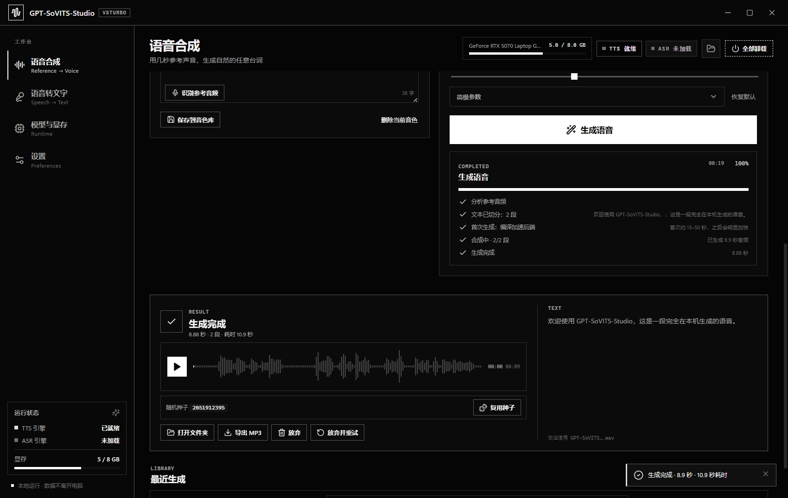 | 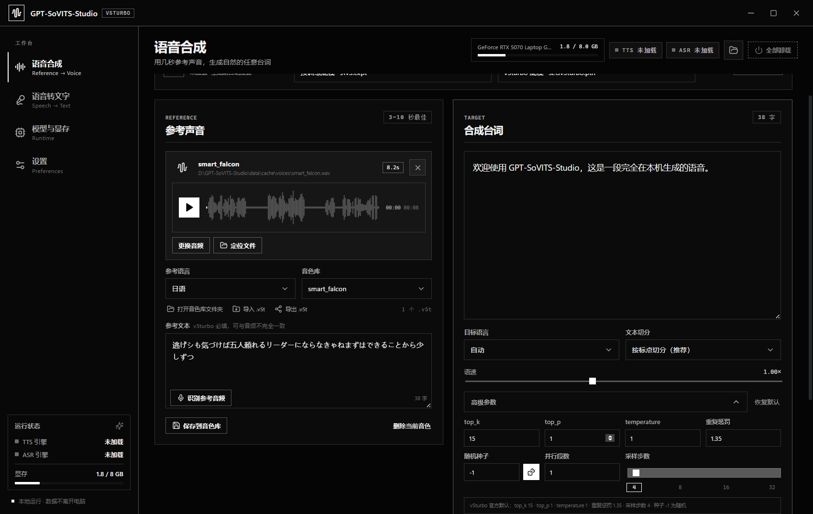 |
| 结果卡、波形播放、种子复用、批量历史 | 采样步数四档滑块、种子随机按钮 |

### 语音转文字

支持添加多个文件或整个文件夹，识别结果按文件列出，可直接编辑；每行都有「发送到生成参考」。

| 待识别音频 | 识别结果 |
| :---: | :---: |
| 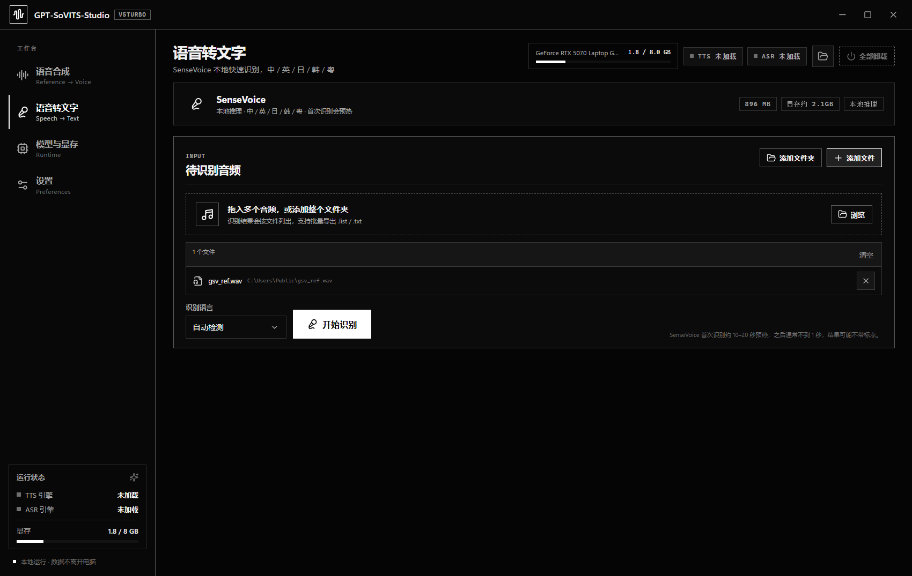 | 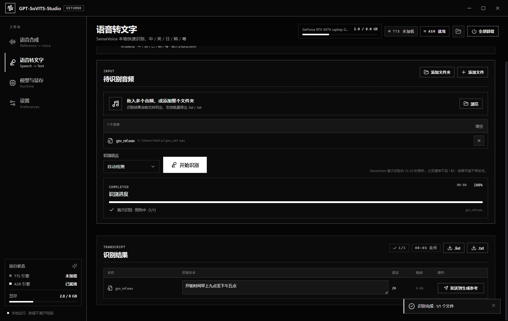 |
| 拖入文件 / 文件夹，批量识别 | 结果可编辑，支持导出 `.list` / `.txt` |

<p align="center">
  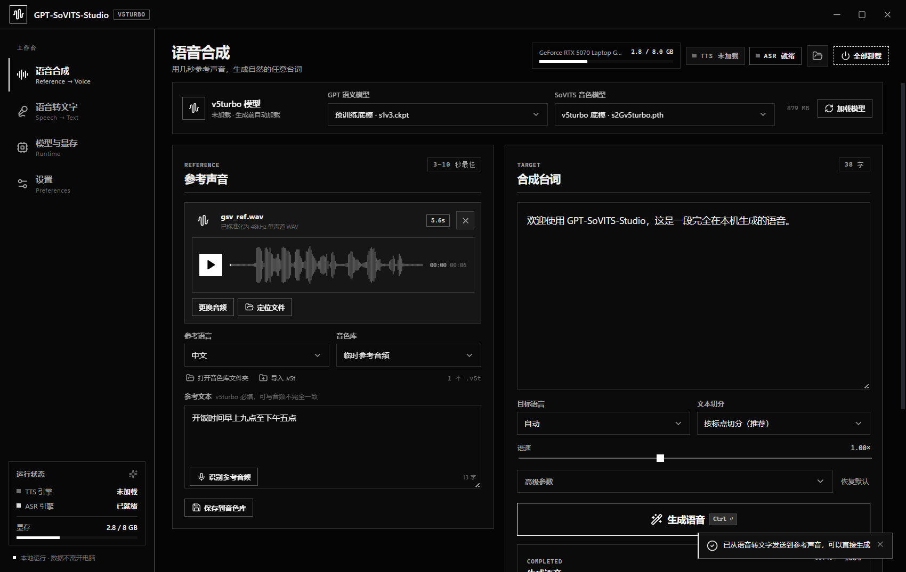
  <br />
  <sub>ASR 结果一键发送到语音合成页，音频和识别文本自动填入参考区</sub>
</p>

### 声音与音色库

音色库使用单文件 `.v5t` 格式：参考音频、参考文本、参考语言和时长都在一个文件里。复制给别人就能分享，也可以直接导入。

<p align="center">
  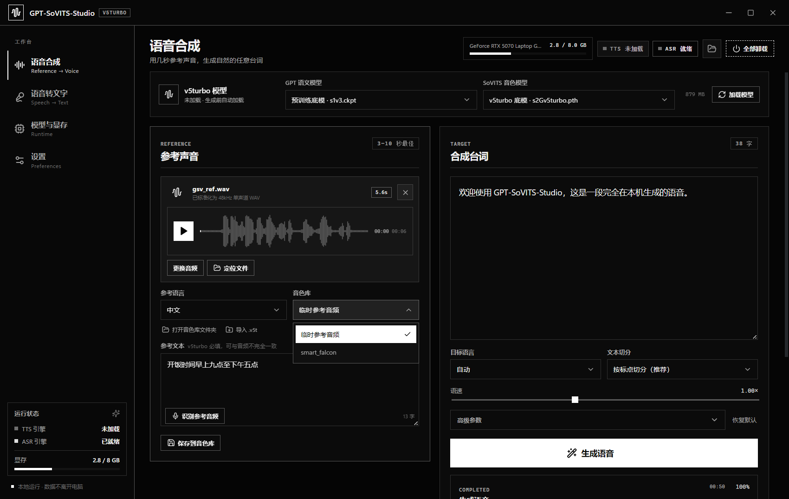
  <br />
  <sub>音色库下拉 · 自定义应用内菜单，深色 / 浅色主题下都清晰</sub>
</p>

### 主题

应用内置两套风格，每套都支持深色、浅色和跟随系统：

- **黑白 Mono**：默认主题。去色、直角矩形、1px 线条，无阴影 / 渐变 / 毛玻璃。
- **彩色**：紫青渐变风格，保留原有的视觉层次。

| 黑白 · 深色 | 黑白 · 浅色 |
| :---: | :---: |
| 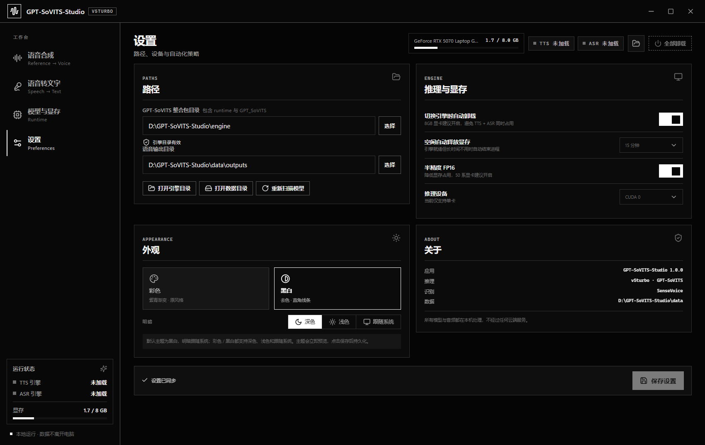 | 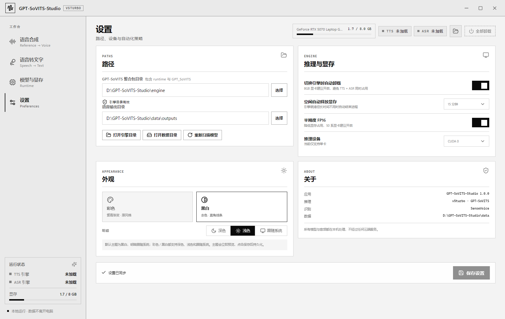 |
| 黑底白线 | 白底黑线 |

<p align="center">
  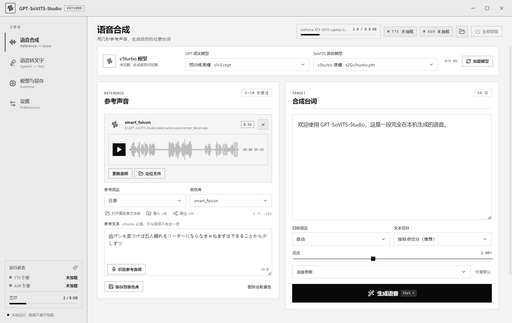
  <br />
  <sub>黑白浅色主题 · 白底黑线、直角线框</sub>
</p>

### 模型与显存

模型页展示每个引擎当前加载了什么、torch 显存占用、全局显存，以及切换 / 空闲 / 退出时的释放策略。

<p align="center">
  
  <br />
  <sub>模型状态、显存占用、资源策略和运行日志</sub>
</p>

---

## 安装

### 下载安装包

在 GitHub **Releases** 下载以下两个文件：

```text
GPT-SoVITS-Studio-Setup.exe
GPT-SoVITS-Studio-Portable.7z
```

> **两个文件必须放在同一个文件夹。** 由于 Windows exe 受 PE 4GB 限制，10.9GB 的模型和运行时无法塞进单个 Setup.exe，因此采用「安装器 + 压缩包」的标准形式。安装器本身仍然是 exe。压缩包约 **5.5GB**，安装后约 **11GB**。

双击 `GPT-SoVITS-Studio-Setup.exe`，选择安装路径，点击「安装」。安装器会：

- 检查目标路径是否可写、磁盘空间是否足够；
- 解压程序、运行时和模型；
- 实时显示解压进度；
- 默认创建桌面快捷方式；
- 安装完成后可选择立即启动。

| 选择安装位置 | 解压进度 | 安装完成 |
| :---: | :---: | :---: |
| 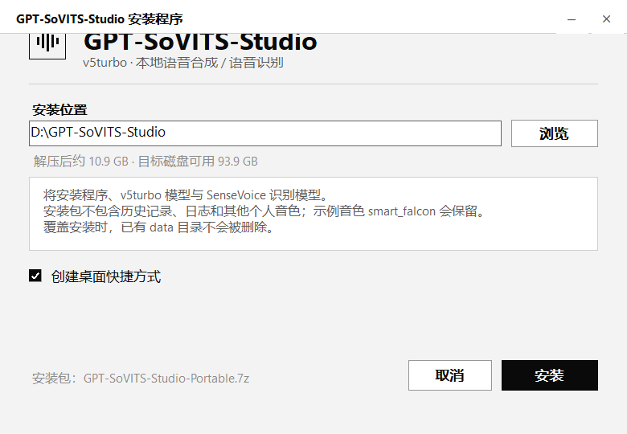 | 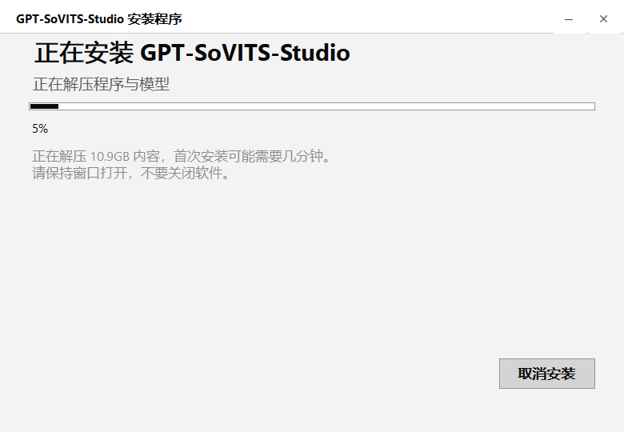 | 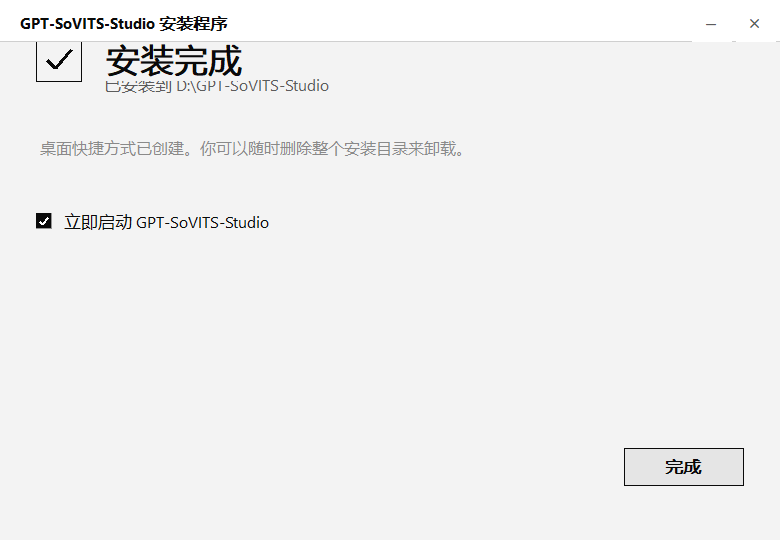 |

安装包不包含历史记录、日志和其他个人音色，只附带示例音色 `data/voices/smart_falcon.v5t`。覆盖安装时，已有 `data` 目录会保留。

也可以直接用 7-Zip 解压 `GPT-SoVITS-Studio-Portable.7z`，作为绿色便携版运行。

### 系统要求

| 项目 | 建议 |
| --- | --- |
| 系统 | Windows 10 / 11 64-bit |
| 显卡 | NVIDIA GPU，建议 8GB 以上显存（已在 RTX 5070 Laptop 8GB 上测试） |
| 内存 | 16GB 以上，推荐 32GB |
| 磁盘 | 安装后约 11GB，另需空间保存生成结果 |
| Python / Electron | 安装包已自带，无需单独安装 |

CPU 模式可以运行，但速度会明显变慢；TTS 和 ASR 都优先使用 CUDA。

### 首次启动

- 第一次启动可能需要 **1–3 分钟**：Windows 会扫描新复制的 runtime，同时导入 PyTorch / GPT-SoVITS。
- 第一次生成会编译加速后端，约 **15–50 秒**；之后通常几秒完成。
- SenseVoice 第一次识别会预热约 **10–20 秒**，之后通常不到 1 秒。

---

## 使用说明

### 1. 语音合成

1. 拖入一段 **3–10 秒**的干净人声；
2. 点「识别参考音频」自动填入参考文本，或手动输入；
3. 在「合成台词」里输入目标文本，选择目标语言和文本切分方式；
4. 需要时展开「高级参数」，调整 top_k、top_p、temperature、重复惩罚、采样步数等；
5. 点「生成语音」，等待分段进度完成；
6. 结果可播放、打开文件夹、导出 MP3，也可以「放弃」或「放弃并重试」。

参考音频和参考文本越匹配，克隆效果通常越稳定。参考文本不需要和音频逐字一致，但应能描述音频内容。

### 2. 随机种子

- 种子设为 `-1` 表示每次随机；
- 生成完成后，worker 会返回实际使用的种子；
- 结果卡和「最近生成」里都有「复用种子」按钮，可把种子填回参数，复现同一段语音；
- 种子输入框右侧的骰子按钮可以一键设回 `-1`。

### 3. 字幕导出

生成语音的同时会写一份同名 `.timing.json`，记录每句的真实起止时间。字幕文本直接来自输入的台词，
不需要再跑语音识别，因此没有识别错误，也不会多等一遍。

- 为什么准：合成改成了**逐句生成**，每句的时长就是实际音频的样本数，句间的停顿按设定间隔补足；
  每句还会去掉首尾静音，字幕的入点和出点贴着人声。
- 长句会按标点拆成多条，切点尽量落在句子里的自然换气停顿上；太短的相邻句会合并。
- 疑似静音或时长异常的句子会自动换种子重试，仍异常会在结果卡上提示，方便你重生成。
- 结果卡可导出 **SRT / ASS / VTT / LRC / TXT / 时间轴 JSON**，默认格式和每条字数、短句合并、
  偏移、ASS 字体都在「设置 → 字幕」里调。
- 打开「生成时自动输出字幕」后，音频旁会直接写出所选格式，不用再点导出。
- 最近生成每行有字幕按钮；批量管理可以勾选多条、多选格式，一次导出到同一个文件夹。

```text
data/outputs/
  你好，这是字幕时间轴测….wav
  你好，这是字幕时间轴测….timing.json
  你好，这是字幕时间轴测….srt
```

> 旧版本生成的记录没有时间轴，需要重新生成一次才能导出字幕。

### 4. 语音转文字

1. 添加文件或整个文件夹；
2. 选择识别语言（默认自动检测）；
3. 点「开始识别」；
4. 结果可以直接在表格里编辑；
5. 支持导出 `.list` / `.txt`；
6. 每行右侧的「发送到生成参考」会把该音频和文本带回语音合成页。

### 5. 音色库与 `.v5t`

所有音色都在 `data/voices` 下，每个音色是一个 `.v5t` 单文件：

```text
data/voices/
  smart_falcon.v5t
  旁白 · 温柔女声.v5t
```

`.v5t` 内含参考音频、名称、参考文本、参考语言和时长。合成页音色库下方提供：

- **打开音色库文件夹**
- **导入 `.v5t`**（支持多选）
- **导出 `.v5t`**

把 `.v5t` 发给别人，对方导入后即可复用同一参考声音。安装包附带的 `smart_falcon.v5t` 就是示例音色。

### 6. 显存策略

| 引擎 | 显存 | 说明 |
| --- | --- | --- |
| TTS v5turbo | 约 4.4GB | 加载约 14 秒，首次生成含加速编译 |
| SenseVoice | 约 2.1GB | 加载约 2 秒，首次识别会预热 |

8GB 显卡上，TTS 和 SenseVoice 同时常驻会很紧张，因此默认：

- 切换引擎时自动卸载另一个；
- 空闲 15 分钟自动释放（可设置）；
- 点「卸载」= 结束 Python worker，CUDA 上下文和显存由系统回收；
- 右侧托盘图标右键可查看 TTS / ASR 状态与显存占用，并卸载单个或全部模型；
- 退出应用或窗口崩溃时，worker 会通过 stdin EOF 和父进程 watchdog 自行结束。

### 7. 连接 AI（MCP）

「设置 → AI 连接」里打开 MCP 服务，本机会启动一个只监听 `127.0.0.1` 的 MCP 服务（默认端口 39281，
需要 Bearer token）。共 22 个工具，其中 `unload_models {which:'tts'|'asr'|'all'}` 让 agent 在整段任务结束后
自行释放显存（它会排进 GPU 队列，不会打断正在生成的任务）。打开后可以：

- **一键连接**：自动写入 Claude Code / Claude Desktop / Codex / Cursor / opencode / Kiro /
  Gemini CLI / VS Code / Cline 的配置，原文件备份为 `.gsv-backup`；
- **复制提示词**：把这句提示词粘贴给任意 agent，它会自己写好配置并验证；
- **stdio 桥接**：`data/mcp/gsv-mcp.js`，软件没开时 agent 调用会自动以托盘模式拉起，不弹窗口。

agent 能做的事：

| 场景 | 做法 |
| --- | --- |
| 动画配音 | `list_voices` 选音色 → `synthesize_script` 逐行生成，按行 id 命名，附 manifest 和字幕 |
| 视频译制 | 外部切句 + `transcribe` → 翻译 → 逐行合成 → 字幕/混音 |
| 建音色库 | 先按文件名或数据表自行分组（软件不做角色区分），再 `create_voice` 存成 `.v5t` |

agent 生成的内容会出现在「最近生成」里，抢占同一块显卡时界面操作优先；调用记录写进 `data/logs/mcp.log`。

### 8. 分段重新生成

长文本里有一句没读好，不用整段重来。在「最近生成」每行点剪刀按钮：

- 上方是整段时间轴，下方是句子列表，异常句排在前面；单击选一句，Shift 连选几句；
- 可以只改种子，也可以改语速、温度、采样步数、topK、topP、重复惩罚，还能直接改这一句的文本（字幕同步）；
- 一次生成 1–8 个候选，可以单独听，也可以「带上下文」听前一句 → 候选 → 后一句；
- 确认后替换进完整音频：后面的句子整体平移，句间停顿不变，默认自动匹配前后句响度；
- 第一次替换前自动备份原始音频，可「撤销上一步」，也可「还原原始」。

> 替换过的记录会标「已编辑」，不再提供「复用种子」，但仍可正常导出字幕。

### 9. 说话人分离与译制

「语音转文字」页顶部新增说话人分离：

1. 选一个视频或音频（视频会自动提取音频）；
2. 人数可选自动，或直接指定 2–8 人；
3. 结果是逐句的「谁、什么时候、说了什么」，低置信度的句子用虚线标出；
4. 说话人可以改名、把某句改派给别人、或把两个人合并；
5. 每个说话人旁边可以试听代表片段，或一键「创建音色」，直接用这个人的原声做参考；
6. 「导出逐句稿」会生成带 `start` / `end` / `speaker` / `text` 的 JSON，可直接喂给 agent 做译制。

配合 MCP 的 `synthesize_script`（每行传 `start`/`end`）和 `mix_dub`，就是一条完整的译制配音流水线：
分离 → 翻译 → 按时间窗合成（超长自动压语速、必要时变速，仍放不下会报 `overflow`）→ 混回视频。

> 重叠说话会归给其中一人；短于 1 秒的句子、音色相近的人、有背景音乐时容易分错，所以界面上保留了手动改派。

### 10. 添加训练好的权重

把文件放进：

```text
engine/GPT_weights_v5turbo/*.ckpt
engine/SoVITS_weights_v5turbo/*.pth
```

然后在「模型与显存」页点「刷新模型列表」，合成页即可选择。默认底模是：

- GPT：`GPT_SoVITS/pretrained_models/s1v3.ckpt`
- SoVITS：`GPT_SoVITS/pretrained_models/gsv-v5-pretrained/s2Gv5turbo.pth`

---

## 技术架构

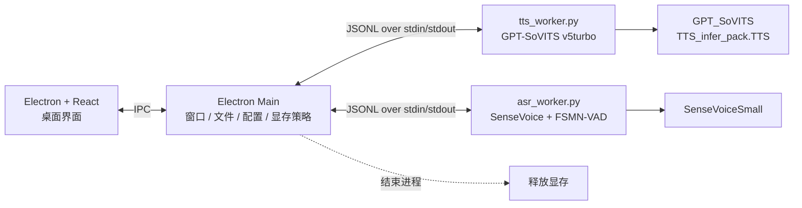

- **Electron + React + TypeScript + Vite**：桌面窗口、页面状态、文件选择和进度展示。
- **两个独立 Python worker**：TTS 与 ASR 各自一个进程，通过 stdin/stdout JSONL 通信。
- **不经过 Gradio、不启动 HTTP 服务**：所有请求都在进程间完成。
- **MCP 服务在主进程内**：`src/main/mcp/` 自带的精简 MCP（Streamable HTTP + stdio 桥接），
  和界面共用同一套 worker、存储和显卡队列。
- **显存生命周期明确**：卸载即杀 worker；切换引擎自动释放另一个；退出/崩溃由 watchdog 兜底。

---

## 项目结构

```text
├─ src/
│  ├─ main/        Electron 主进程、IPC、模型扫描、存储、分段编辑、混音
│  │  └─ mcp/      MCP 服务、工具、客户端配置
│  ├─ preload/     安全 API bridge
│  └─ renderer/    React 界面、主题、页面
├─ python/
│  ├─ tts_worker.py   逐句合成 + 时间轴
│  ├─ timing.py       静音 / 换气 / 异常时长分析
│  ├─ diarize.py      VAD + CAM++ + 聚类
│  └─ asr_worker.py
├─ installer/      C# WinForms 安装器源码
├─ scripts/        构建、引擎精简、安装器打包
├─ resources/      图标
└─ package.json
```

> `engine/`、`data/`、`release/` 不进入源码仓库。模型和运行时通过 `scripts/prepare-engine.ps1` 从本地 GPT-SoVITS v5 整合包准备。

---

## 从源码运行

### 环境

- Windows 10 / 11 64-bit
- Node.js 20+
- 本地已有一份 GPT-SoVITS v5 整合包（包含 `runtime/python.exe`）
- 安装器构建需要 .NET Framework 4.8（Windows 10/11 自带）

```powershell
npm install
npm run dev
```

开发时应用会自动寻找同级的 `GPT-SoVITS-v5-*` 整合包；也可以在「设置」里手动选择。

### 常用命令

```powershell
npm run typecheck
npm run build
npm run dev
```

### 构建绿色便携版

```powershell
powershell -NoProfile -ExecutionPolicy Bypass -File scripts/build-portable.ps1 -Force
```

这会从本地整合包复制一个精简引擎（约 10.5GB），输出到 `release/GPT-SoVITS-Studio/`。

### 构建安装器

```powershell
powershell -NoProfile -ExecutionPolicy Bypass -File scripts/build-installer.ps1
```

输出：

```text
release/installer/
  GPT-SoVITS-Studio-Setup.exe
  GPT-SoVITS-Studio-Portable.7z
  安装说明.txt
  SHA256.txt
```

安装器使用 LZMA2 压缩，构建时间取决于 CPU，通常需要 20–60 分钟。

---

## 已知限制

- 目前仅支持 **Windows 10 / 11 x64**。
- 优先推荐 NVIDIA GPU；CPU 可以跑，但速度慢。
- SenseVoice 结果可能不带标点，可在结果表直接编辑。
- 安装器和主程序未签名，首次运行可能触发 SmartScreen。
- 安装包采用「Setup.exe + Portable.7z」两文件，原因是 Windows PE 的 4GB exe 限制。
- 只保留推理和识别，不包含训练、UVR5 人声分离、切片等工具。
- 第一次启动、第一次生成和第一次识别都会有预热时间。
- Electron 运行时约 250MB，相对于 11GB 引擎可以忽略。
- MCP 不负责区分说话人：从游戏或长录音里提取角色音色时，按文件名、数据表或人工分组。
- MCP 的批量任务按顺序执行，进度靠 `job_status` 轮询，没有逐字实时推送。
- 说话人分离依赖 CAM++（约 28MB，随安装包附带）；重叠语音、过短语句和相似音色仍可能分错。
- 分段重生只支持本程序写出的 PCM16 WAV；替换后的记录不能再用参数复现。

---

## 常见问题

**Q：需要联网吗？**  
不需要。模型、运行时、音色和生成结果都在本机。

**Q：模型和音色在哪里？**  
模型在 `engine/`，音色在 `data/voices/`，生成结果在 `data/outputs/`。

**Q：为什么安装器需要两个文件？**  
Windows 的 exe 受 PE 格式约 4GB 限制，10.9GB 的模型无法塞进单个可执行文件。安装器保持为小体积 exe，压缩包放在旁边。

**Q：显存不够怎么办？**  
到「模型与显存」点「卸载并释放显存」，或使用顶栏「全部卸载」。默认切换引擎会自动释放另一个。

**Q：能用于商业项目吗？**  
请同时遵守 GPT-SoVITS、SenseVoice 等上游模型和代码的许可证，并确保你拥有参考声音的使用权。

---

## 致谢

本项目建立在以下开源工作之上：

- [GPT-SoVITS](https://github.com/RVC-Boss/GPT-SoVITS) — v5turbo 语音合成
- [SenseVoice](https://github.com/FunAudioLLM/SenseVoice) — 多语言语音识别
- [FunASR](https://github.com/modelscope/FunASR) — 语音识别生态
- [Electron](https://www.electronjs.org/) / [React](https://react.dev/) / [Vite](https://vitejs.dev/)
- [framer-motion](https://www.framer.com/motion/) / [lucide](https://lucide.dev/)
- [7-Zip](https://www.7-zip.org/) — 安装包压缩与解压

模型权重、运行时和第三方组件遵循各自上游许可证。

---

## License

应用层代码的开源许可证待补充；发布前请在仓库根目录添加 `LICENSE` 文件。

GPT-SoVITS、SenseVoice、Electron 及其他依赖/模型遵循各自上游许可。

---

<div align="center">
  <sub>请仅将语音克隆用于合法、获得授权的内容。不要用于仿冒、诈骗或侵犯他人声音权益。</sub>
</div>
