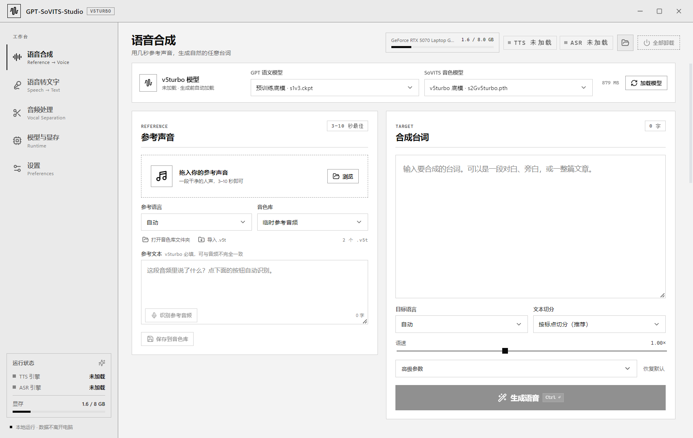
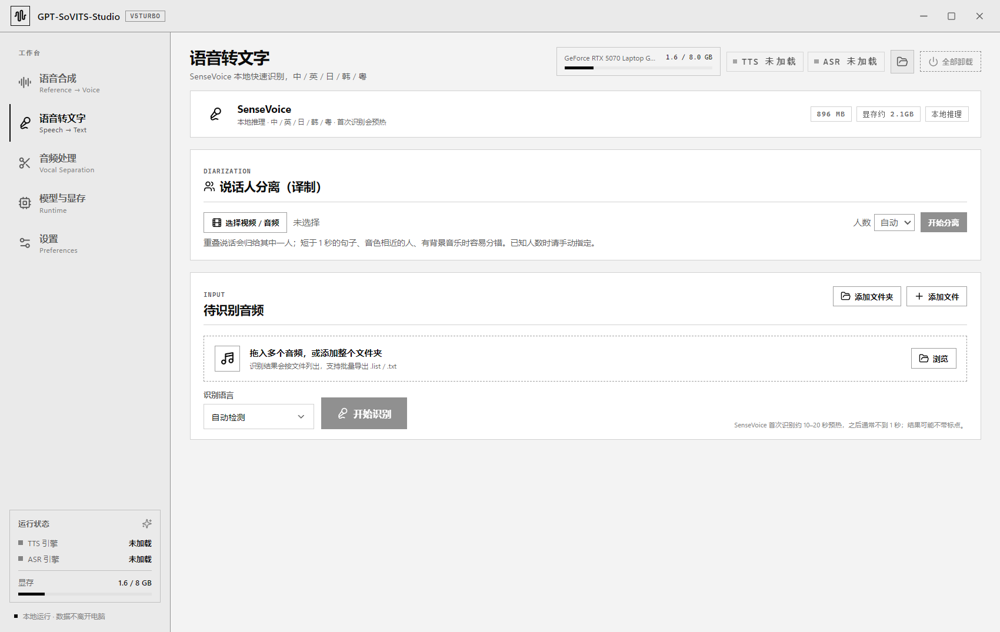
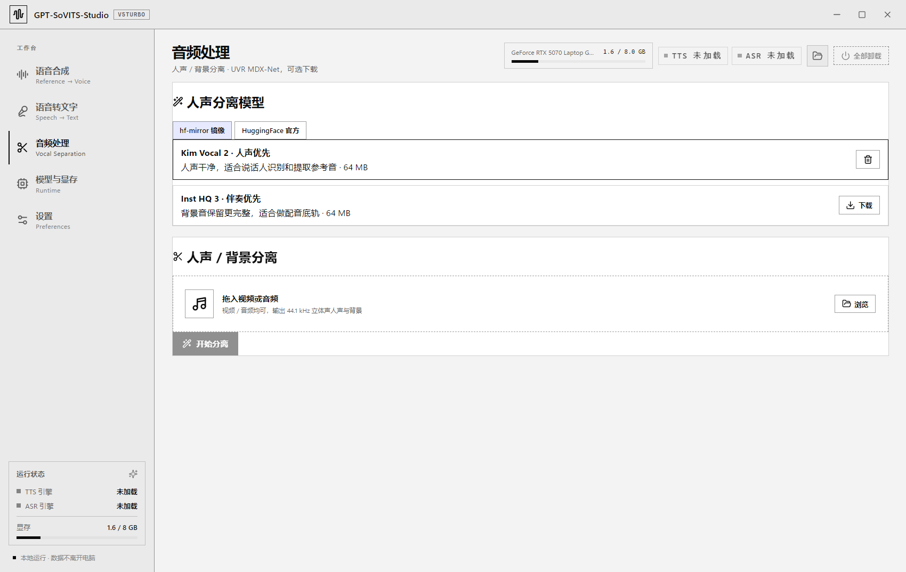
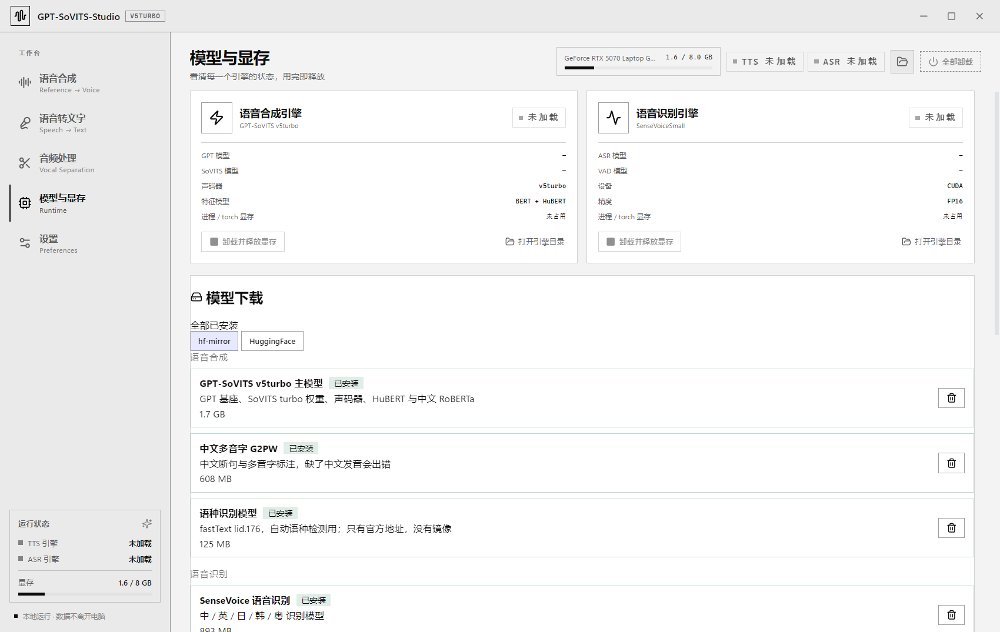
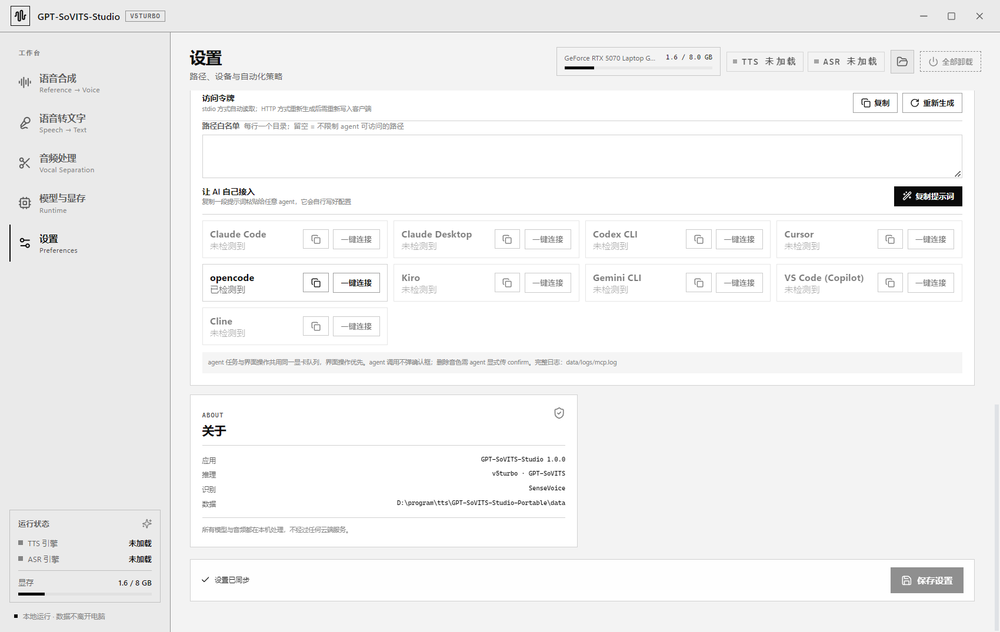
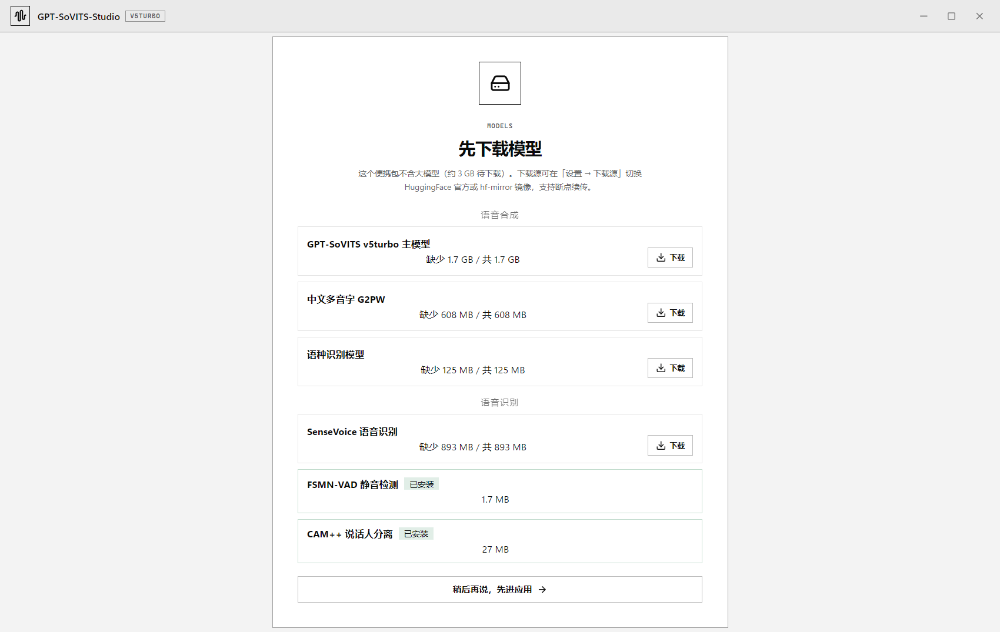
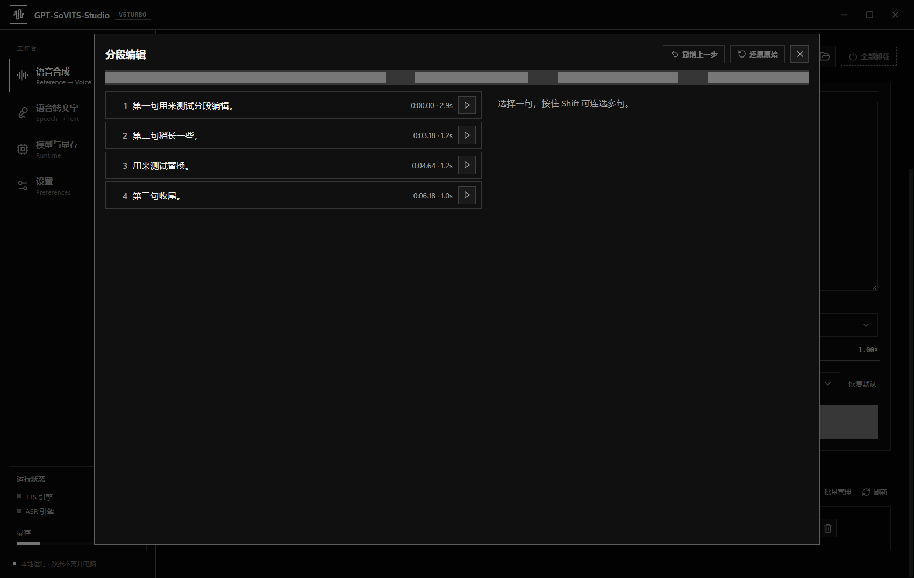
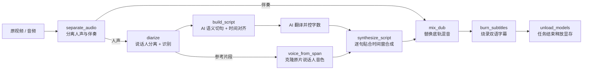

<div align="center">


# GPT-SoVITS-Studio

**把 GPT-SoVITS v5turbo、SenseVoice、说话人分离与人声分离装进一个开箱即用的桌面工作台——还能直接交给 AI Agent 驱动。**

[](#)
[](#)
[](#)
[](#)
[](#)

[核心能力](#核心能力) · [界面一览](#界面一览) · [快速上手](#快速上手) · [MCP：让 AI 自己干活](#mcp让-ai-自己干活) · [工作流](#典型工作流) · [显存与模型](#显存与模型)

</div>

---

它不是把 WebUI 套个壳。**GPT-SoVITS-Studio** 砍掉了训练、数据集切片等重型页面，只保留**推理、识别、音色管理、人声分离、译制配音**这几条高频链路，由 Electron 主进程直接调度 Python worker，并用原生 **MCP 服务** 把全部能力暴露给 Claude Code、Codex、Cursor、opencode 等 AI 客户端。

<p align="center">
  
</p>

---

## 核心能力

| 模块 | 能做什么 |
|---|---|
| **v5turbo 语音合成** | 3–10 秒参考音频即可克隆；支持语速、采样步数（4 / 8 / 16 / 32）、段间间隔、随机种子复用与历史批量导出 |
| **SenseVoice 语音识别** | 中 / 英 / 日 / 韩 / 粤本地高速识别；结果可编辑、批量导出，或**一键发送到参考声音**继续合成 |
| **`.v5t` 音色库** | 每个音色打包成单个 `.v5t` 文件（参考音频 + 文本 + 语言），像发图片一样直接分享、导入、导出 |
| **同步字幕** | 逐句合成并按真实音频算时间轴，导出 **SRT / ASS / VTT / LRC / TXT / JSON**，时间点对齐到声音 |
| **分段重生** | 长台词只有某一句念劈了？只重做那一句，改种子/参数/文本，试听满意再无缝替换，支持撤销 |
| **人声 / 背景分离** | 内置 UVR MDX-Net（Kim Vocal 2 / Inst HQ 3，约 64 MB 按需下载），把视频拆成干净人声与伴奏底轨 |
| **说话人分离（CAM++）** | 自动区分多人对话，输出每句起止时间、说话人与文本，并挑出每个说话人的最佳参考片段 |
| **双语字幕烧录** | 中文大字在上、英文小字在下（也支持上下分栏或软字幕封装），长句自动切短，中英同步分段 |
| **8 GB 显卡友好** | 实时显示显存占用；切换引擎自动卸载旧模型，空闲自动释放，托盘右键随时一键释放 |
| **MCP 驱动** | 27 个本地 MCP 工具 + SSE 实时进度；一句话让 AI 自动完成整条视频译制或批量建音色库 |

---

## 界面一览

默认采用 **黑白 Mono（跟随系统）** 主题，去色、1 px 线条、无多余装饰；同时也提供深色与彩色主题。

<table>
  <tr>
    <td width="50%">
      
      <div align="center"><sub><b>语音转文字 & 说话人分离</b> · SenseVoice + CAM++</sub></div>
    </td>
    <td width="50%">
      
      <div align="center"><sub><b>音频处理</b> · UVR MDX-Net 人声 / 背景分离</sub></div>
    </td>
  </tr>
  <tr>
    <td width="50%">
      
      <div align="center"><sub><b>模型与显存</b> · 按需下载、断点续传、显存监控</sub></div>
    </td>
    <td width="50%">
      
      <div align="center"><sub><b>设置 & AI 连接</b> · 一键配置主流 AI 客户端</sub></div>
    </td>
  </tr>
</table>

<details>
<summary>更多界面：首次启动模型下载引导 · 长句分段编辑器</summary>

<table>
  <tr>
    <td width="50%">
      
      <div align="center"><sub><b>精简包首次启动引导</b> · 按需拉取大模型</sub></div>
    </td>
    <td width="50%">
      
      <div align="center"><sub><b>分段重生</b> · 单独重做某一句并试听替换</sub></div>
    </td>
  </tr>
</table>

</details>

---

## 快速上手

### 1. 安装与首次启动

提供两种分发形式，都在 Windows 10 / 11 上直接运行，无需单独配置 Python 环境：

- **安装版（`GPT-SoVITS-Studio-Setup.exe`）**：选择安装路径，自动创建桌面快捷方式；覆盖安装时保留 `data/` 里的音色和历史记录。
- **绿色便携版**：解压即用，双击 `GPT-SoVITS-Studio.exe`。

如果下载的是**不含大模型的精简版**（约 6.5 GB，比完整版小 4.4 GB），首次打开会自动进入模型下载引导页：

- 支持 **hf-mirror 镜像** 与 **HuggingFace 官方** 切换；
- 支持断点续传（`.part`）与 `sha256` 校验；
- 也可以先点「稍后再说」进入主界面，之后随时在「模型与显存」页补下。

### 2. 三步完成一次语音合成

1. **导入参考声音**：把 3–10 秒的干净人声拖进参考区（自动标准化为 48 kHz 单声道 WAV），点「识别参考音频」自动填入文本，或直接从左侧选一个已保存的 `.v5t` 音色。
2. **输入台词**：填好目标文本，按需展开高级参数调整语速、采样步数（4–32）、段间间隔（0–1.5 s）或固定随机种子。
3. **生成与导出**：点「生成语音」，完成后可直接试听、导出 MP3、导出同步字幕，或点「分段编辑」单独重做其中某一句。

---

## MCP：让 AI 自己干活

在「设置 → AI 连接」打开 MCP 服务后，本机只监听 `127.0.0.1`（Bearer token 鉴权）。点一下对应客户端的「一键配置」，即可接入 **Claude Code / Codex / Cursor / opencode** 等工具，一共暴露 **27 个工具**。

### 你可以直接这样对 AI 说

> **🎬 视频译制（从原片到双语配音成片）**
>
> `https://www.youtube.com/watch?v=xxxx 帮我把这个视频译制成中文，用原视频里的声音建立音色，加上中英双语字幕，先做前两分钟试试。`

> **🎮 游戏语音提取与音色库构建**
>
> `帮我把 D:\Games\VoiceLines 文件夹里提取出来的角色语音整理一下，挑干净的片段做成 .v5t 音色库，每个角色建一个音色并测试一句中文台词。`

> **🎙️ 长文本配音与精修**
>
> `用 smart_falcon 这个音色把这段剧本按角色拆句合成，导出 SRT 字幕；如果第 4 句语调不对，用分段重生多生成几个候选挑最好的换上，做完记得释放显存。`

### AI 在背后走的是这样一条流水线



> **安全边界**：MCP 默认「读取放开、写入收紧」——允许读取本地素材，但**写入严格限制在输出目录、数据目录和白名单目录内**，禁止覆盖输入文件、禁止写进系统/程序目录、禁止写出可执行扩展名。

---

## 典型工作流

### 本地可视化操作

```text
语音合成   拖入参考音 → 识别参考文本 → 输台词 → 生成 → 导出 WAV / MP3 / 字幕
长句精修   结果卡点「分段编辑」 → 选中念坏的那一句 → 改种子/参数预览多版 → 替换并保留字幕
语音识别   拖入音频或文件夹 → SenseVoice 识别 → 编辑文本 → 一键「发送到生成参考」
人声分离   音频处理页下载 Kim Vocal 2 → 拖入视频或歌曲 → 一键输出人声 + 伴奏 WAV
```

### 关闭与托盘

- **点窗口右上角 `×`**：弹出应用内确认框，选择「最小化到托盘」或「直接退出」（可勾选记住，在设置里随时改回）。
- **最小化到托盘后**：MCP 服务和已加载模型继续保留，不打断正在进行的任务。
- **托盘图标右键**：随时查看 TTS / ASR 状态和显存占用，一键卸载 TTS、ASR 或全部模型。

---

## 显存与模型

8 GB 显卡（例如 RTX 4060 / 5070 Laptop）上同时常驻两个大模型会比较紧张，因此内置了三道显存保护：

| 引擎 | 典型显存 | 说明 |
|---|---|---|
| **GPT-SoVITS v5turbo** | 约 4.4 GB | 首次生成含加速编译，之后很快 |
| **SenseVoiceSmall** | 约 2.1 GB | 加载约 2 秒 |
| **UVR MDX-Net** | 独立短进程 | 分离完自动退出，不常驻显存 |

- **切换自动卸载**：从合成切到识别时自动结束旧进程，系统立即回收 CUDA 显存。
- **空闲自动释放**：默认 15 分钟无操作自动卸载（可在设置调整）。
- **Agent 协同**：`unload_models` 会排进共享 GPU 队列，等当前正在生成的句子跑完再释放，不会误杀任务。

---

<div align="center">

**本地运行 · 数据不离开电脑**

</div>
